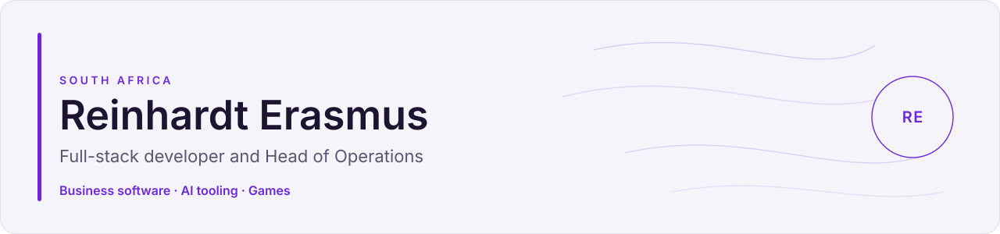

  <picture>
    <source media="(prefers-color-scheme: dark)" srcset="./assets/banner-dark.svg">
    
  </picture>

  
  &nbsp;
  
  &nbsp;
  
  &nbsp;
  
  &nbsp;
  

Open to collaborations and opportunities.

  I build business software, AI tooling, and games, from production systems to public experiments. 
  I still run the operations those systems have to survive, at Food Fair.

6+ years in software.

## Focus

<table>
<tr>
<td width="33%" valign="top">
<h3>Business software</h3>
Production systems for operating businesses: inventory, orders, delivery notes, and reporting. Food Fair and Jasmyn are built for people using them on the floor.
</td>
<td width="33%" valign="top">
<h3>AI and automation</h3>
Rust tooling for coding agents, a RAG pipeline for client FAQs, and real-time detection on drone video. The public pieces are Relaybook, Orca, Valyra, and a FAQ auto-reply pipeline.
</td>
<td width="33%" valign="top">
<h3>Games</h3>
A voxel MMO in Rust and Bevy with a Unity client, and smaller games in the browser and Unreal. Oda Clan Wars is the one you can open and play.
</td>
</tr>
</table>

## Selected work

### Business software

<table>
<tr>
<td width="50%" valign="top">
<h3><a href="https://www.reinhardterasmus.info/projects/food-fair-management-system">Food Fair Management System</a></h3>
Operations platform for Food Fair covering production, inventory, orders, delivery notes, and reporting across web and mobile clients.
  
<a href="https://www.reinhardterasmus.info/projects/food-fair-management-system">Case study</a>
</td>
<td width="50%" valign="top">
<h3><a href="https://www.reinhardterasmus.info/projects/jasmyn-plaasprodukte">Jasmyn Plaasprodukte</a></h3>
Public site for a Hartbeespoort farmstall, plus a Next.js rebuild and a chatbot on the contact form.
  
<a href="https://www.reinhardterasmus.info/projects/jasmyn-plaasprodukte">Case study</a>
</td>
</tr>
</table>

### AI and automation

<table>
<tr>
<td width="50%" valign="top">
<h3><a href="https://github.com/Spottie97/relaybook">Relaybook</a></h3>
Shared work ledger for coding agents: plan with Claude, build with Cursor, and keep context small.
  
<a href="https://github.com/Spottie97/relaybook">Repository</a>
</td>
<td width="50%" valign="top">
<h3><a href="https://www.reinhardterasmus.info/projects/orca-agent-cli">Orca Agent CLI</a></h3>
Rust CLI that scans a repo, keeps project memory, and routes coding tasks across AI providers.
  
<a href="https://www.reinhardterasmus.info/projects/orca-agent-cli">Case study</a>
&nbsp;·&nbsp;
<a href="https://github.com/Spottie97/orca-agent-cli">Repository</a>
</td>
</tr>
<tr>
<td width="50%" valign="top">
<h3><a href="https://www.reinhardterasmus.info/projects/valyra">Valyra</a></h3>
Real-time object detection on DJI drone video, with a PyQt6 interface and YOLOv8.
  
<a href="https://www.reinhardterasmus.info/projects/valyra">Case study</a>
&nbsp;·&nbsp;
<a href="https://github.com/Spottie97/drone-tracking-human-detection">Repository</a>
</td>
<td width="50%" valign="top">
<h3><a href="https://www.reinhardterasmus.info/projects/faq-auto-reply">FAQ Auto-Reply</a></h3>
RAG pipeline that answers a client's FAQs on email and WhatsApp using n8n, Ollama, and Qdrant.
  
<a href="https://www.reinhardterasmus.info/projects/faq-auto-reply">Case study</a>
&nbsp;·&nbsp;
<a href="https://github.com/Spottie97/ai-automation-n8n-workflow">Repository</a>
</td>
</tr>
</table>

### Games

<table>
<tr>
<td width="50%" valign="top">
<h3><a href="https://www.reinhardterasmus.info/projects/elderweald">Elderweald</a></h3>
Voxel MMO in Rust and Bevy, with a Unity client: nine kindreds, procedural biomes, and a dedicated server.
  
<a href="https://www.reinhardterasmus.info/projects/elderweald">Case study</a>
</td>
<td width="50%" valign="top">
<h3><a href="https://www.reinhardterasmus.info/projects/oda-clan-wars">Oda Clan Wars</a></h3>
Local two-player browser fighting game. Empty the health bar, or have more left when the timer ends.
  
<a href="https://www.reinhardterasmus.info/projects/oda-clan-wars">Case study</a>
&nbsp;·&nbsp;
<a href="https://github.com/Spottie97/2D-Fight-Simulator">Repository</a>
</td>
</tr>
</table>

## Stack

<strong>Frontend</strong>

  <picture>
    <source media="(prefers-color-scheme: dark)" srcset="https://skillicons.dev/icons?i=ts,nextjs,react,tailwind,vite&theme=dark">
    
  </picture>

<strong>Backend and data</strong>

  <picture>
    <source media="(prefers-color-scheme: dark)" srcset="https://skillicons.dev/icons?i=nodejs,supabase,postgres,prisma&theme=dark">
    
  </picture>

<strong>AI and automation</strong>

  <picture>
    <source media="(prefers-color-scheme: dark)" srcset="https://skillicons.dev/icons?i=rust,python&theme=dark">
    
  </picture>

  
  &nbsp;
  
  &nbsp;
  
  &nbsp;
  
  &nbsp;
  

<strong>Games</strong>

  <picture>
    <source media="(prefers-color-scheme: dark)" srcset="https://skillicons.dev/icons?i=rust,bevy,cs,cpp,unity,unreal&theme=dark">
    
  </picture>

<strong>Infrastructure</strong>

  <picture>
    <source media="(prefers-color-scheme: dark)" srcset="https://skillicons.dev/icons?i=docker,vercel,githubactions&theme=dark">
    
  </picture>

  

## GitHub

  <picture>
    <source media="(prefers-color-scheme: dark)" srcset="https://github-profile-summary-cards.vercel.app/api/cards/repos-per-language?username=Spottie97&theme=github_dark">
    
  </picture>
  &nbsp;
  <picture>
    <source media="(prefers-color-scheme: dark)" srcset="https://github-profile-summary-cards.vercel.app/api/cards/most-commit-language?username=Spottie97&theme=github_dark">
    
  </picture>

## Contact

  <a href="https://www.reinhardterasmus.info/contact">Contact page</a>
  &nbsp;·&nbsp;
  <a href="mailto:reinhardterasmus@gmail.com">reinhardterasmus@gmail.com</a>
  &nbsp;·&nbsp;
  <a href="https://wa.me/27834003092">WhatsApp</a>

